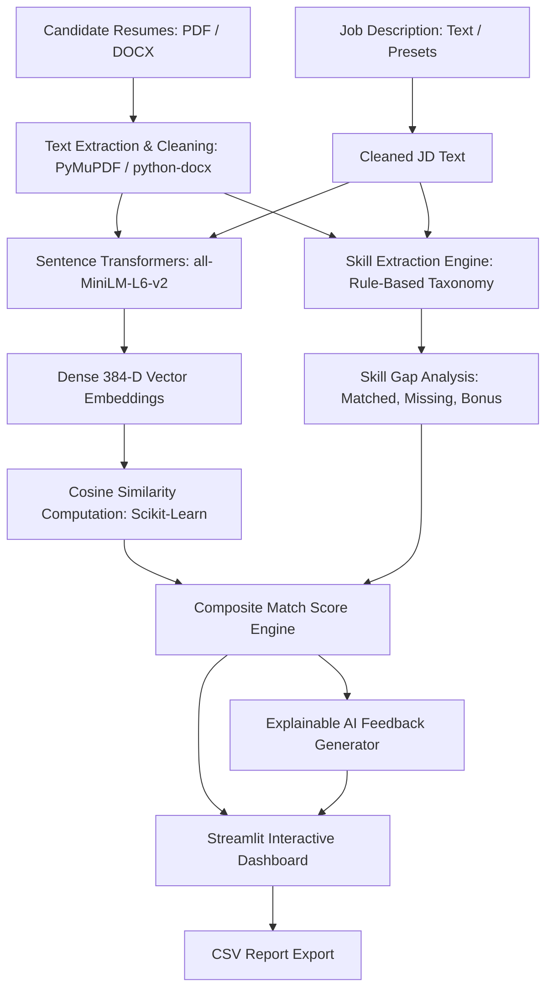

# 📄 AI Resume Screening and Job Matching System
### *College Mini Project | Natural Language Processing & Intelligent Decision Support*

---

## 🌟 Executive Summary
The **AI Resume Screening and Job Matching System** is an intelligent candidate evaluation platform designed to automate and augment traditional recruitment workflows. Built with modern Natural Language Processing (NLP), the system extracts textual data from multi-page **PDF** and **DOCX** resumes, projects documents into 384-dimensional dense semantic vector spaces via **Sentence Transformers (`all-MiniLM-L6-v2`)**, performs **Skill Gap Analysis** across a domain-specific technical taxonomy, and computes an explainable, balanced composite score.

Unlike black-box ATS (Applicant Tracking Systems), this project features an **Explainable AI (XAI)** diagnostic engine that highlights exact candidate strengths, detects missing skill requirements, and provides actionable optimization feedback for candidates and recruiters.

---

## 🚀 Key Features

- **Multi-Format Resume Ingestion**: Robust text extraction from `.pdf` (via PyMuPDF) and `.docx` (via python-docx) with handling for corrupted or empty documents.
- **Deep Semantic Similarity**: Context-aware embeddings using a pretrained local sentence transformer model (`all-MiniLM-L6-v2`) and Scikit-Learn Cosine Similarity.
- **Domain-Specific Skill Taxonomy**: Extracts technical skills across Programming, AI/ML, Cloud/DevOps, Databases, Web Frameworks, and Soft Skills.
- **Job Description Intelligence**: Parses JD into Required vs. Preferred skills, extracts seniority experience targets, education prerequisites, and audits clarity/buzzwords.
- **Automated Skill Gap Analysis & Upskilling**: Categorizes skills into Matched, Missing, and Bonus competencies with personalized learning roadmaps, project blueprints, and estimated study times.
- **Side-by-Side Candidate Comparison**: Head-to-head comparison of multiple candidates highlighting common skills, individual differentiators, and score distributions.
- **Grounded Fact vs. AI Inference**: Strictly distinguishes verified resume text citations from model inferences to eliminate hallucinations.
- **Separate User & Admin Portals**: Dual dedicated portals with distinct visual identities:
  - **User Portal (Blue & Cyan)**: Candidate resume creation, AI screening studio, semantic matching, personal skill gaps, and telemetry.
  - **Admin Command Center (Purple & Dark)**: Full governance console for user lifecycle management, candidate resume tracking, job specifications, and database analytics.
- **Persistent SQLite Relational Storage**: Production-grade local SQLite database (`data/airesume.db`) storing user accounts, uploaded resumes, job specifications, screening history, and single-use password reset tokens with parameterized SQL queries.
- **Military-Grade Bcrypt Authentication & RBAC**: Salted password hashing with 12 bcrypt rounds, brute-force login rate limiting, session token invalidation, and strict server-side role enforcement (`admin` vs `user`).
- **Dynamic Composite Scoring**: Recruiter-configurable weights for semantic similarity vs. hard skill overlap, plus custom shortlist thresholds.
- **Explainable AI (XAI) Feedback**: Transparent explanations of scores, metric quantification checks, and concrete resume improvement recommendations.
- **Modern SaaS Interface**: Premium Navy, Electric Blue, Violet, and Cyan design system with Dark and Light mode toggles, skeleton loaders, and glassmorphism.
- **CSV Export**: Instant download of complete screening reports with CSV formula injection protection for HR records and audit compliance.
- **Zero Paid API Cost**: Runs 100% locally on CPU without requiring an OpenAI, Anthropic, or external cloud API key.
- **Ethical AI by Design**: Disregards protected characteristics (gender, age, race, religion, etc.) to ensure fair, merit-based decision support.

---

## 🛠️ Technology Stack

| Component | Technology | Purpose |
| :--- | :--- | :--- |
| **Language** | Python 3.10+ / 3.14 | Core application programming |
| **Web Dashboard** | Streamlit | Reactive frontend and user interface |
| **NLP Embeddings** | Sentence-Transformers (`all-MiniLM-L6-v2`) | Contextual dense vector representation |
| **Vector Similarity** | Scikit-Learn (`cosine_similarity`) | Mathematical cosine distance calculation |
| **PDF Extraction** | PyMuPDF (`fitz`) | High-speed multi-page PDF text extraction |
| **DOCX Extraction** | `python-docx` | Word document paragraph and table parsing |
| **Data Manipulation** | Pandas | Structured tables, ranking, and CSV export |
| **Machine Learning** | PyTorch / SciPy | Local tensor computation and execution |

---

## 📐 System Architecture & Workflow



---

## 📁 Project Directory Structure

```text
resume/
│
├── .streamlit/
│   └── config.toml             # Custom theme colors and Streamlit server configuration
│
├── sample_data/
│   ├── job_descriptions/       # Sample JDs (AI Engineer, Full-Stack, Data Scientist)
│   │   ├── ai_ml_engineer.txt
│   │   └── full_stack_developer.txt
│   └── resumes/                # Automatically generated realistic sample PDF & DOCX resumes
│       ├── Alex_Rivera_AI_Engineer.pdf
│       ├── Priya_Sharma_FullStack.docx
│       ├── Jordan_Lee_DataScientist.pdf
│       └── Sam_Taylor_JuniorDev.pdf
│
├── src/
│   ├── __init__.py             # Package marker
│   ├── auth.py                 # Supabase & salted-hash sandbox authentication engine
│   ├── constants.py            # Skill taxonomies, preset JDs, default weights & disclaimers
│   ├── embeddings.py           # Pretrained SentenceTransformer model loader & cosine similarity
│   ├── jd_analyzer.py          # Job description intelligence, required/preferred parsing, clarity audit
│   ├── learning_recommender.py # Skill gap upskilling roadmaps and learning blueprints
│   ├── parsers.py              # PDF/DOCX extractors, text cleaning, metadata heuristics
│   ├── profile_extractor.py    # Grounded fact extractor (degrees, experience, fact vs inference)
│   ├── ranker.py               # Composite scoring, leaderboard ranking, and XAI feedback
│   ├── skills_extractor.py     # Skill taxonomy matching and skill gap analysis
│   ├── styles.py               # Premium Navy/Blue/Violet/Cyan design system & CSS variables
│   └── utils.py                # CSV generation, file validators, sample resume generator
│
├── app.py                      # Main Streamlit web application
├── test_pipeline.py            # Automated end-to-end pipeline verification test script
├── requirements.txt            # Python dependencies
├── .gitignore                  # Git ignore rules
│
├── project_report.md           # 🎓 Full Academic Project Report (Abstract, Architecture, Math, Results)
├── presentation.md             # 📊 10-12 Slide PowerPoint Presentation Outline with Speaker Notes
├── viva_questions.md           # 💡 28 Likely Viva Voce Questions & Authoritative Answers
├── test_cases.md               # 🧪 Normal, Edge-Case & Error-Handling Test Matrix (30/30 Passed)
├── screenshot_checklist.md     # 📸 Step-by-Step UI Screenshot Capture Guide for College Report
├── DEPLOYMENT.md               # 🚀 Online Deployment Guide (Streamlit Cloud & Hugging Face Spaces)
└── README.md                   # Comprehensive project overview and developer setup guide
```

---

## 💻 Step-by-Step Installation & Setup in VS Code

### 1. Open the Project Folder in VS Code
Launch VS Code and open this directory (`File` > `Open Folder...` > select `resume`).

### 2. Open Integrated Terminal in VS Code
Press `` Ctrl + ` `` (Control + Backtick) or navigate to `Terminal` > `New Terminal`.

### 3. Create a Virtual Environment (if not already created)
```powershell
python -m venv .venv
```
*(On Windows systems where `python` defaults to the Microsoft Store alias, use your Python path or launcher: `py -m venv .venv`)*

### 4. Activate the Virtual Environment
- **Windows (PowerShell)**:
  ```powershell
  .\.venv\Scripts\Activate.ps1
  ```
  *(If PowerShell displays an execution policy restriction, run: `Set-ExecutionPolicy -Scope Process -ExecutionPolicy Bypass`)*
- **Windows (Command Prompt)**:
  ```cmd
  .venv\Scripts\activate.bat
  ```
- **macOS / Linux**:
  ```bash
  source .venv/bin/activate
  ```

### 5. Install Dependencies
```powershell
pip install -r requirements.txt
```

---

## 🔐 Authentication, RBAC & Separate Portals

The system provides **two completely separate authentication portals and role-based access control (RBAC)**:

```
                      ┌───────────────────────────────────────────────┐
                      │              🏠 Main Landing Page             │
                      │   (Hero Showcase, Features, Portal Gateways)  │
                      └───────────────────────┬───────────────────────┘
                                              │
                      ┌───────────────────────┴───────────────────────┐
                      │                                               │
                      ▼                                               ▼
     ┌───────────────────────────────────┐           ┌───────────────────────────────────┐
     │      👤 Candidate & User Portal    │           │    🛡️ Admin Command Center Portal  │
     │   (Blue & Cyan Modern Design)     │           │     (Purple & Dark Governance)    │
     ├───────────────────────────────────┤           ├───────────────────────────────────┤
     │ • User Registration (role='user') │           │ • Strict Superadmin Gateway       │
     │ • User Login with Rate Limiting   │           │ • admin@airesume.com verification │
     │ • Resume Builder (4 ATS Formats)  │           │ • User Lifecycle Management       │
     │ • AI Resume Screening Studio      │           │ • Candidate Resume Governance     │
     │ • Semantic Match & Ranking Podium │           │ • Job Description CRUD Control    │
     │ • Skill Gap Roadmaps & Upskilling │           │ • Database Telemetry & CSV Audits │
     │ • Candidate Head-to-Head Compare  │           │ • Bcrypt Password Security        │
     │ • Personal Profile & Settings     │           │ • Admin Session Sign Out          │
     └───────────────────────────────────┘           └───────────────────────────────────┘
```

### 1. Initial Administrator Credentials
During application startup, the system automatically checks for the primary superadministrator in the persistent SQLite database (`data/airesume.db`). If not already present, it is automatically provisioned:
- **Admin Email**: `admin@airesume.com`
- **Default Password**: `ResumeAdmin@2026!`
- **Role**: `admin`
- **Account Status**: `active`
- **Security**: Password is cryptographically hashed with `bcrypt` (cost factor 12). Plaintext passwords are never stored.
- **Configurable**: Configurable via environment variables `ADMIN_EMAIL` and `ADMIN_PASSWORD`.
- **Idempotent**: Will never create duplicate administrator accounts on repeated app startups.

### 2. User Registration & Login Instructions
1. Navigate to **👤 User Login** from the sidebar or click **"👤 User Login"** on the landing page.
2. To create a new account, click **"📝 Register New Account"**:
   - Provide your **Full Name**, **Work/Personal Email**, choose a **Role Persona**, enter a password (min 6 characters, 1 letter, 1 number), and confirm your password.
   - The system verifies passwords match, hashes with bcrypt, assigns `role='user'`, and stores the account in SQLite.
3. Sign in using your email and password.
4. Upon successful authentication, you are immediately routed to your **📊 User Dashboard**.
5. **Security Isolation**: Normal users never see administrative navigation links, admin controls, or other users' private records.

### 3. Administrator Login & Governance Instructions
1. Navigate to **🛡️ Admin Login** or click **"🛡️ Admin Login"** on the landing page.
2. Enter the administrator credentials (`admin@airesume.com` / `ResumeAdmin@2026!`).
3. Alternatively, click the **"⚡ Fast Sign In with Default Admin"** evaluation helper.
4. Regular user accounts are **strictly blocked** with `"Access Denied: Administrator privileges required."`
5. Upon successful administrator authentication, you are routed to the **🛡️ Admin Dashboard**.

### 4. Admin Dashboard Governance Modules
- **📊 System Overview**: Live counters for total registered users, active permitted users, candidate resumes stored, jobs analyzed, and total neural screening operations.
- **👥 User Management**: Real-time user table with search, role badges, one-click **Activate / Deactivate** account status toggles, permanent delete with confirmation popovers, and manual account provisioning. Never displays passwords or hashes.
- **📁 Resume Management**: Global resume tracking showing uploaded filenames, candidate names, contact details, word counts, and extracted skills with deletion controls.
- **💼 Job Management**: Full CRUD interface to create, calibrate, edit, and delete job descriptions and required skills.
- **📈 Analytics & Reports**: Visual distributions of candidate match scores, user role breakdowns, and one-click authoritative CSV audit exports (Users, Resumes, Screening History).
- **⚙️ Admin Profile**: Inspect account metadata, change administrator password (verified against current password before updating), and securely log out.

### 5. Persistent SQLite Relational Schema (`data/airesume.db`)
- `users`: `id`, `email UNIQUE`, `full_name`, `password_hash`, `role`, `status`, `created_at`, `last_login`.
- `resumes`: `id`, `user_id FK`, `filename`, `file_type`, `word_count`, `extracted_email`, `candidate_name`, `skills_detected`, `uploaded_at`, `status`.
- `screening_records`: `id`, `user_id`, `job_title`, `candidate_name`, `filename`, `composite_score`, `semantic_score`, `skill_score`, `decision`, `screened_at`.
- `jobs`: `id`, `title UNIQUE`, `department`, `experience_level`, `description`, `created_by`, `created_at`.
- `password_resets`: `token PK`, `email`, `expires_at`, `used`.

### 6. Security & Defense in Depth
- **Cryptographic Hashing**: Bcrypt with salt (12 rounds). Zero plaintext passwords.
- **Server-Side RBAC Enforcement**: Role checks on both client-side navigation and server-side page router dispatching. Direct URL or session-state tampering is immediately intercepted and blocked.
- **Brute-Force Rate Limiting**: In-memory sliding window locking accounts after 5 consecutive failed login attempts.
- **Account Status Validation**: Deactivated or suspended accounts are instantly barred from logging in.
- **Parameterized SQL Queries**: All queries across `src/database.py` use parameterized SQL (`?`) to eliminate SQL injection vulnerabilities.
- **Formula Injection Mitigation**: All exported CSV files prepend safety quotes (`'`) to values starting with `=`, `+`, `-`, or `@`.

---

## 🧪 Run Automated Verification & Test Suite

### 1. Comprehensive Test Suite (68 Tests)
Run all 68 automated unit, integration, and security tests:
```powershell
.\.venv\Scripts\python.exe -m unittest discover tests -v
```

### 2. Dedicated Authentication, RBAC & Rate Limiting Tests
```powershell
.\.venv\Scripts\python.exe -m unittest tests/test_admin_and_rbac.py -v
.\.venv\Scripts\python.exe -m unittest tests/test_auth.py -v
```

### 3. End-to-End Complete Flow Verification (14-Step User Spec)
```powershell
.\.venv\Scripts\python.exe -m unittest tests/test_e2e_verification.py -v
```

### 4. End-to-End NLP & Neural Pipeline Verification
```powershell
.\.venv\Scripts\python.exe test_pipeline.py
```

---

## 🖥️ Launch the Streamlit Web Application

To run the interactive web dashboard on Windows:
```powershell
.\.venv\Scripts\python.exe -m streamlit run app.py
```
*(Running via `python -m streamlit` avoids PowerShell execution policy or application control blocks on Windows)*

Streamlit will launch local server at:
```text
Local URL: http://localhost:8501
Network URL: http://192.168.x.x:8501
```
Your browser will open automatically.

---

## 📖 How to Use the Application

1. **Step 1: Choose or Enter a Job Description**
   - Use the **Role Preset** dropdown to load sample job requirements (e.g., *AI / Machine Learning Engineer*, *Full-Stack Developer*, *Data Scientist*), or paste custom text into the text area.
2. **Step 2: Upload Resumes**
   - Click the file uploader and select one or more candidate resumes in `.pdf` or `.docx` format.
   - Alternatively, click the **"📁 Load Sample Test Candidates"** button in the sidebar to test immediately with built-in realistic resumes.
3. **Step 3: Adjust Scoring Weights (Optional)**
   - Use the sidebar sliders to customize the balance between **Semantic Similarity** (context) and **Skill Overlap** (exact technical keywords).
4. **Step 4: Click "Run Screening & Matching Analysis"**
   - The system analyzes resumes in real-time, displays progress indicators, and populates the dashboard tabs.
5. **Step 5: Review Results & Export**
   - **Candidate Leaderboard**: View ranked candidates and shortlist flags.
   - **Candidate Deep Dive**: Explore matched, missing, and bonus skills.
   - **Comparative Matrix**: Visualize comparative score charts across all applicants.
   - **Explainable AI**: Read actionable recommendations for resume optimization.
   - **Download CSV**: Click the download button to export the comprehensive spreadsheet report.

---

## ⚖️ Ethical AI & Bias Mitigation Framework

Hiring algorithms must adhere to ethical standards. This project implements:
1. **Blind Feature Ingestion**: Protected personal characteristics (gender, age, ethnicity, religious indicators, marital status, disability status, physical appearance) are omitted from the scoring function.
2. **Decision-Support Classification**: The system outputs a *textual alignment estimate*, explicitly disclaiming that it does not represent hiring certainty or human worth.
3. **Transparent Explainability**: Instead of an opaque score, the system provides transparent lists of matched keywords and missing prerequisites.

---

## 🎓 College Viva Voce / Project Defense Q&A

**Q1: Why use Sentence Transformers instead of standard TF-IDF or Word2Vec?**  
> **Answer**: TF-IDF only matches identical words and fails when candidates use synonyms (e.g. "building neural networks" vs. "deep learning modeling"). Word2Vec averages word vectors, losing syntactic sentence context. Sentence Transformers (`all-MiniLM-L6-v2`) use self-attention to generate holistic, contextual sentence-level embeddings that capture true semantic intent.

**Q2: How does Cosine Similarity evaluate resume match?**  
> **Answer**: Cosine similarity measures the angle between two multi-dimensional vectors in space:
> $$\text{Cosine Similarity}(\vec{u}, \vec{v}) = \frac{\vec{u} \cdot \vec{v}}{\|\vec{u}\| \|\vec{v}\|}$$
> If a resume and job description have identical semantic orientation, the cosine of the angle is 1.0 (100% similarity).

**Q3: How are missing skills determined?**  
> **Answer**: The system uses set difference operations on detected skills:
> $$\text{Missing Skills} = \text{Skills}_{\text{Job Description}} \setminus \text{Skills}_{\text{Resume}}$$

**Q4: Can this system run offline?**  
> **Answer**: Yes. Once the model weights for `all-MiniLM-L6-v2` are cached locally during the first run, the entire application executes completely offline on standard CPU hardware with zero external API calls.

---

## 📄 License & Academic Attribution
Developed as an open-source academic mini project. Free for educational and research use.
