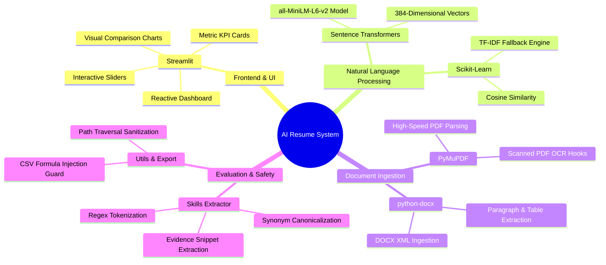
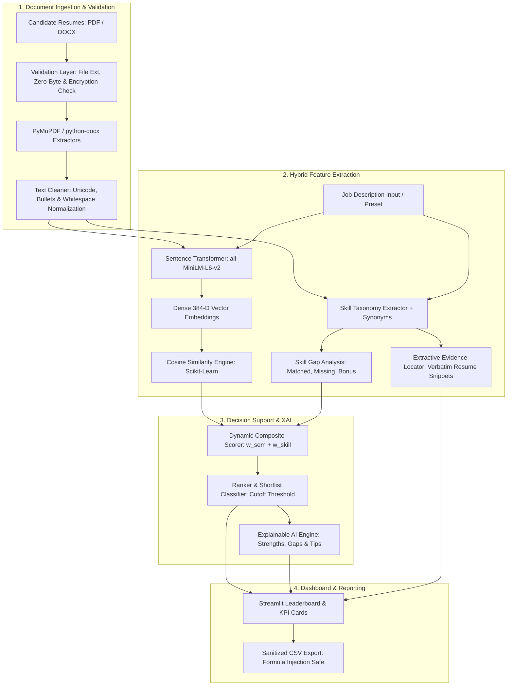

# AI Resume Screening and Job Matching System
## Final Academic Project Report

---

### Project Metadata
- **Project Title:** AI Resume Screening and Job Matching System
- **Domain:** Artificial Intelligence, Natural Language Processing (NLP), Intelligent Information Retrieval
- **Technology Stack:** Python, Streamlit, Sentence-Transformers (`all-MiniLM-L6-v2`), Scikit-Learn, PyMuPDF, python-docx, Pandas
- **Target Audience:** College Examination Board, Technical Evaluators, HR Technology Researchers
- **Academic Year:** 2025–2026

---

## 1. Abstract

In contemporary recruitment workflows, corporate human resource departments receive hundreds to thousands of curriculum vitae (resumes) for every advertised position. Traditional keyword-based Applicant Tracking Systems (ATS) rely on exact character-for-character substring matching, frequently failing when qualified applicants express their expertise using synonyms or distinct phrasing. Conversely, unconstrained proprietary Large Language Model (LLM) APIs introduce high recurring costs, token latency, and significant privacy concerns regarding the unauthorized cloud transmission of personally identifiable candidate data.

This project presents the **AI Resume Screening and Job Matching System**, a local, privacy-preserving, and explainable intelligent decision-support application. The system integrates:
1. **Multi-format Document Ingestion**: High-throughput text and metadata extraction from multi-page `.pdf` (via PyMuPDF) and `.docx` (via python-docx) documents with graceful error boundaries for corrupt, encrypted, or empty files.
2. **Dense Contextual Embeddings**: 384-dimensional semantic document representations generated locally via the pretrained `all-MiniLM-L6-v2` Sentence Transformer model, capturing semantic concepts independent of verbatim vocabulary.
3. **Domain-Specific Technical Taxonomy with Synonym Canonicalization**: Rule-based skill extraction covering programming languages, AI/ML libraries, cloud platforms, databases, and frameworks, utilizing synonym resolution (`k8s` $\to$ `kubernetes`, `postgres` $\to$ `postgresql`) and single-letter contextual disambiguation (preventing false positives on common words like "C", "R", and "Go").
4. **Transparent Composite Scoring & Verifiable Evidence Extraction**: A recruiter-configurable scoring engine balancing deep semantic similarity and hard technical skill coverage, accompanied by verbatim textual excerpts extracted from the resume and actionable, non-hallucinatory resume optimization suggestions.

The entire platform operates locally on standard CPU hardware with zero external API dependencies, zero cloud data leakage, and zero financial cost.

---

## 2. Introduction & Problem Statement

### 2.1 Background
The hiring lifecycle begins with candidate sourcing and resume screening. Recruiters spend an average of six to eight seconds performing initial manual resume reviews. As recruitment platforms digitized, automated ATS solutions were deployed to filter candidates based on keyword frequency.

### 2.2 Problem Statement
Conventional automated resume screening approaches suffer from three fundamental deficiencies:
1. **The Lexical Chasm (Synonym Failure)**: A job description requiring *"container orchestration and cloud clustering"* will fail to match a candidate resume highlighting *"Kubernetes, Docker Swarm, and EKS"* under legacy keyword-based search algorithms.
2. **Black-Box Opacity & Hallucinations**: Recent attempts to employ generative AI APIs (such as GPT-4) suffer from stochastic variance, potential hallucination of qualifications, unpredictable operational costs, and vendor lock-in.
3. **Data Privacy & Compliance Risks**: Transmitting personal resumes containing candidate names, email addresses, phone numbers, and career histories to third-party proprietary cloud APIs violates emerging data privacy regulations (e.g., GDPR, CCPA).

### 2.3 Proposed Solution
The proposed system addresses these challenges by combining **deterministic, rule-based skill extraction** with **locally-hosted dense transformer semantic embeddings**. This hybrid architecture guarantees:
- Full contextual comprehension of candidate experience.
- Complete explainability with transparent mathematical score breakdowns.
- Verifiable proof through direct quotation of resume evidence.
- Total data security via 100% offline local CPU execution.

---

## 3. Objectives & Scope

### 3.1 Project Objectives
- To engineer a high-performance document parser capable of extracting and normalizing text from PDF and DOCX files while handling edge cases such as empty files, scanned documents, and encrypted archives.
- To implement semantic document embeddings using a lightweight local Transformer architecture (`all-MiniLM-L6-v2`) and calculate cosine similarity against target job descriptions.
- To design a comprehensive technical skill taxonomy with canonical synonym mapping and contextual disambiguation to eliminate false-positive keyword matches.
- To formulate a transparent, bounded composite scoring mechanism combining contextual semantic similarity and technical skill coverage with configurable weights.
- To provide Explainable AI (XAI) diagnostic feedback, highlighting matched competencies, missing prerequisites, verifiable resume evidence, and concrete resume improvement recommendations.
- To construct an interactive, responsive Streamlit dashboard featuring candidate leaderboards, score benchmarking charts, and sanitized CSV report exports.

### 3.2 Scope of the System
- **In-Scope**:
  - Processing candidate resumes in `.pdf` and `.docx` formats.
  - Multi-candidate batch analysis and dynamic leaderboard ranking.
  - Interactive parameter tuning (semantic weight, skill weight, shortlist cutoff).
  - Exporting tamper-resistant, injection-safe CSV screening reports.
  - Ethical AI framework excluding protected personal attributes (gender, age, race, religion) from evaluation.
- **Out-of-Scope**:
  - Fully automated, autonomous hiring decisions without human recruiter oversight.
  - Video interview facial or voice tone analysis.
  - Direct integration into commercial enterprise HRIS systems (e.g., Workday, SAP SuccessFactors).

---

## 4. Existing System vs. Proposed System

| Parameter | Existing Legacy Systems (ATS) | Commercial Cloud LLM Wrappers | Proposed AI Screening System |
| :--- | :--- | :--- | :--- |
| **Matching Paradigm** | Keyword substring search | Generative prompt completions | Hybrid: Dense Semantic Embeddings + Rule Taxonomy |
| **Synonym Handling** | Fails completely | Variable / Non-deterministic | Deterministic Synonym Canonicalization (`SKILL_SYNONYMS`) |
| **Execution Cost** | Minimal | High (Recurring API tokens) | **Zero ($0.00)** (100% local CPU execution) |
| **Privacy & Security** | Local database | Data transmitted to 3rd-party cloud | **100% Private** (No external network requests) |
| **Explainability** | Opaque keyword count | Plausible but unverifiable prose | **Mathematical formula + Verbatim text evidence** |
| **Hallucination Risk** | None (Deterministic) | High (May invent qualifications) | **Zero** (Strict extractive evidence matching) |
| **Robustness** | Often crashes on malformed files | Subject to API timeouts/rate-limits | Graceful error catching for corrupt/encrypted files |

---

## 5. Hardware & Software Requirements

### 5.1 Hardware Specifications
- **Processor**: Intel Core i3 / AMD Ryzen 3 or higher (Quad-core 2.0 GHz recommended).
- **RAM**: Minimum 4 GB (8 GB recommended for optimal multi-document batch embedding).
- **Storage**: 500 MB available disk space (includes ~120 MB for cached `all-MiniLM-L6-v2` model weights).
- **GPU**: None required (Architecture optimized for standard CPU inference).

### 5.2 Software Specifications
- **Operating System**: Windows 10/11, macOS 12+, or Ubuntu/Debian Linux 20.04+.
- **Language Runtime**: Python 3.10, 3.11, 3.12, 3.13, or 3.14.
- **Primary Libraries**:
  - `streamlit` ($\ge 1.35.0$): Web dashboard framework.
  - `sentence-transformers` ($\ge 3.0.0$): Pretrained dense embedding pipeline.
  - `torch` ($\ge 2.2.0$): PyTorch tensor operations and inference backend.
  - `scikit-learn` ($\ge 1.4.0$): Vector mathematics and cosine similarity.
  - `pymupdf` ($\ge 1.24.0$): High-speed PDF document parsing.
  - `python-docx` ($\ge 1.1.0$): Word document parsing.
  - `pandas` ($\ge 2.2.0$): Structured data analysis and CSV report generation.

---

## 6. Technologies Used & Their Purpose



1. **Streamlit**: Provides a modern, browser-based user interface with dynamic state management, reactive input sliders, custom metric cards, and responsive tab navigation.
2. **Sentence-Transformers (`all-MiniLM-L6-v2`)**: A MiniLM architecture distilled from BERT/RoBERTa, mapping text passages to a shared 384-dimensional dense vector space where semantic proximity corresponds directly to cosine distance.
3. **Scikit-Learn (`cosine_similarity`)**: Computes vector inner products normalized by Euclidean norms to quantify conceptual alignment between document vectors.
4. **PyMuPDF (`pymupdf`)**: High-performance C-backed PDF parsing engine that extracts raw text streams, detects document encryption, and catches scanned/image-only pages.
5. **python-docx**: Navigates Word OpenXML structures to extract text across both standard paragraphs and multi-column tabular layouts.
6. **Pandas**: Manages structured tabular candidate datasets, multi-criteria sorting, leaderboard ranking, and secure CSV formatting.

---

## 7. System Architecture & Workflow

### 7.1 Architectural Dataflow


### 7.2 Step-by-Step Workflow Description
1. **User Input**: The recruiter pastes or selects a Job Description (JD) and uploads one or more candidate resumes in `.pdf` or `.docx` formats.
2. **File Validation & Safety Check**: Files are inspected for unsupported extensions, zero-byte contents, corruption, and password encryption.
3. **Text Normalization**: Special bullet points (`•`, `*`, `▪`), irregular line breaks, and smart quotes are normalized into clean standard UTF-8 text strings.
4. **Dual-Track Evaluation**:
   - **Track A (Semantic Context)**: The cleaned resume and JD texts are encoded into dense 384-dimensional vector representations. Cosine similarity calculates the contextual match percentage.
   - **Track B (Hard Skill Overlap)**: Both documents are analyzed against an expansive domain-specific technical taxonomy. Skill synonyms are unified to canonical identifiers, and direct substring evidence sentences are captured.
5. **Weighted Composite Scoring**: The system calculates the final candidate score using recruiter-configured weights, guaranteeing that scores remain strictly bounded between $0.0\%$ and $100.0\%$.
6. **Explainability & Review Generation**: The engine categorizes skills into Matched, Missing, and Bonus pools, generates actionable improvement advice, and flags unevidenced requirements for human interviewer follow-up.
7. **Interactive Visualization & Export**: Results are rendered across interactive tabs with sortable leaderboards, comparative charts, and a formula-injection-safe CSV export button.

---

## 8. Mathematical Formulations & Algorithms

### 8.1 Dense Semantic Embeddings & Cosine Similarity
Let document $D_{\text{resume}}$ and job description $D_{\text{JD}}$ be mapped to continuous dense vector representations $\vec{u}, \vec{v} \in \mathbb{R}^{384}$ through the pretrained encoder $\mathcal{M}$:
$$\vec{u} = \mathcal{M}(D_{\text{resume}}), \quad \vec{v} = \mathcal{M}(D_{\text{JD}})$$

The semantic contextual similarity $S_{\text{semantic}}$ is computed as the cosine of the angle between vectors $\vec{u}$ and $\vec{v}$:
$$\text{Cosine Similarity}(\vec{u}, \vec{v}) = \frac{\vec{u} \cdot \vec{v}}{\|\vec{u}\|_2 \|\vec{v}\|_2} = \frac{\sum_{i=1}^{384} u_i v_i}{\sqrt{\sum_{i=1}^{384} u_i^2} \sqrt{\sum_{i=1}^{384} v_i^2}}$$

Because Sentence Transformer embeddings are normalized, the similarity score ranges from $-1.0$ to $1.0$. In the context of resume matching, negative similarities represent orthogonal or irrelevant content. The similarity score is normalized to a percentage:
$$S_{\text{semantic\_pct}} = \max\left(0.0, \min\left(100.0, \text{Cosine Similarity} \times 100\right)\right)$$

### 8.2 Skill Extraction, Synonym Canonicalization & Gap Analysis
Let $\mathcal{T}$ be the technical skill taxonomy and $\mathcal{F}_{\text{canon}}: \text{Token} \to \text{CanonicalSkill}$ be the synonym harmonization function (e.g., $\mathcal{F}_{\text{canon}}(\text{"k8s"}) = \text{"kubernetes"}$).

The extracted skills for the job description and resume are defined as sets:
$$\mathcal{S}_{\text{JD}} = \{ \mathcal{F}_{\text{canon}}(s) \mid s \in D_{\text{JD}} \cap \mathcal{T} \}$$
$$\mathcal{S}_{\text{Resume}} = \{ \mathcal{F}_{\text{canon}}(s) \mid s \in D_{\text{Resume}} \cap \mathcal{T} \}$$

Skill gap categorization is defined through formal set operations:
- **Matched Skills**: $\mathcal{S}_{\text{Matched}} = \mathcal{S}_{\text{JD}} \cap \mathcal{S}_{\text{Resume}}$
- **Missing Skills**: $\mathcal{S}_{\text{Missing}} = \mathcal{S}_{\text{JD}} \setminus \mathcal{S}_{\text{Resume}}$
- **Bonus / Additional Skills**: $\mathcal{S}_{\text{Bonus}} = \mathcal{S}_{\text{Resume}} \setminus \mathcal{S}_{\text{JD}}$

The technical skill match percentage $S_{\text{skill\_pct}}$ is:
$$S_{\text{skill\_pct}} = \begin{cases} 
\left( \frac{|\mathcal{S}_{\text{Matched}}|}{|\mathcal{S}_{\text{JD}}|} \right) \times 100, & \text{if } |\mathcal{S}_{\text{JD}}| > 0 \\
S_{\text{semantic\_pct}}, & \text{if } |\mathcal{S}_{\text{JD}}| = 0 \text{ (Zero-division fallback)}
\end{cases}$$

### 8.3 Bounded Composite Score Calculation
Recruiters configure semantic weight $w_{\text{semantic}} \in [0.0, 1.0]$ and skill weight $w_{\text{skill}} = 1.0 - w_{\text{semantic}}$.

The composite score $S_{\text{composite}}$ is calculated as:
$$S_{\text{composite}} = \text{clamp}\left( (w_{\text{semantic}} \times S_{\text{semantic\_pct}}) + (w_{\text{skill}} \times S_{\text{skill\_pct}}), 0.0, 100.0 \right)$$

Where $\text{clamp}(x, 0.0, 100.0) = \max(0.0, \min(100.0, x))$.

### 8.4 Verifiable Evidence Extraction (Zero Hallucination)
For every matched skill $s \in \mathcal{S}_{\text{Matched}}$, the evidence extractor locates the exact containing sentence in $D_{\text{resume}}$:
$$\text{Evidence}(s) = \text{ExtractSentence}\left(D_{\text{resume}}, \text{BoundaryRegex}(s)\right)$$
If a skill is matched, the system quotes the verbatim sentence (e.g., *"Architected containerized microservices using Docker and Kubernetes clusters on AWS."*). If no contextual sentence is identified, the evidence is left empty rather than generated or hallucinated.

---

## 9. Implementation Details by Module

### 9.1 `src/constants.py`
Contains the static configuration, default parameters, sample role descriptions, and the technical skill taxonomy:
- `DEFAULT_MODEL_NAME = "all-MiniLM-L6-v2"`
- `DEFAULT_SEMANTIC_WEIGHT = 0.60`, `DEFAULT_SKILL_WEIGHT = 0.40`, `DEFAULT_SHORTLIST_THRESHOLD = 60.0`
- `SKILL_TAXONOMY`: Categorized dictionary spanning 6 technical domains (Programming, Web, AI/ML, Cloud/DevOps, Databases, Soft Skills).
- `SKILL_SYNONYMS`: Dictionary mapping alternate spellings, common abbreviations, and synonyms (e.g., `postgres` $\to$ `postgresql`, `ml` $\to$ `machine learning`, `rag` $\to$ `retrieval augmented generation`) to canonical terms.
- `ETHICAL_DISCLAIMER`: Prominently displayed advisory affirming that outputs are decision-support textual alignment estimates rather than definitive hiring verdicts.

### 9.2 `src/parsers.py`
Encapsulates file ingestion and text preprocessing:
- `clean_text(raw_text)`: Eliminates non-printable ASCII characters, normalizes bullet formats, consolidates redundant white space, and handles `None` input gracefully.
- `extract_text_from_pdf(file_input)`: Employs `pymupdf.open()` to process stream bytes or file paths. Checks `doc.is_encrypted` and catches `pymupdf.FileDataError`. Detects scanned/image-only PDFs where zero text characters are found.
- `extract_text_from_docx(file_input)`: Uses `docx.Document()` to parse paragraphs and iterate through embedded table cells.
- `extract_metadata_heuristics(text)`: Extracts candidate email addresses via regex (`[a-zA-Z0-9_.+-]+@[a-zA-Z0-9-]+\.[a-zA-Z0-9-.]+`), phone numbers, LinkedIn/GitHub profiles, and total word count.
- `parse_resume(file_input, filename)`: Unified interface returning a structured dictionary with parsing status, clean text, metadata, and user-facing error messages.

### 9.3 `src/skills_extractor.py`
Implements dictionary-based skill extraction and set-theoretic gap analysis:
- Regex boundary matching: Compiles tokens with word boundaries `\b` while properly escaping symbols in programming languages such as `c++`, `c#`, and `.net`.
- Contextual Disambiguation: Solves false positives for single-letter and common English words (`c`, `r`, `go`). Requires explicit programming context (e.g., *"C programming"*, *"Go language"*, or presence inside a comma-separated skills list) before registering a match.
- `extract_skill_evidence(text, skill_canonical)`: Splits document into sentences and extracts the exact verbatim passage demonstrating candidate experience.

### 9.4 `src/embeddings.py`
Manages vector embedding generation and cosine similarity:
- `load_sentence_transformer_model(model_name)`: Loads `SentenceTransformer` locally. If torch or network dependencies fail, seamlessly falls back to a Scikit-Learn TF-IDF vectorizer engine.
- `compute_semantic_similarity(resume_text, jd_text, model)`: Computes normalized cosine similarity between resume and job description.
- `batch_compute_similarity(parsed_resumes, jd_text, model)`: Computes similarity for multiple documents simultaneously. Automatically assigns `0.0` to corrupted, empty, or unreadable files without breaking batch execution.

### 9.5 `src/ranker.py`
Performs candidate sorting, composite score calculation, and XAI feedback generation:
- `rank_resumes(...)`: Computes composite scores, assigns sequential integer ranks ($1, 2, 3\dots$) to successfully parsed candidates, and assigns rank `"-"` with score `0.0` to failed documents. Produces both a detailed candidate object list and a clean Pandas DataFrame.
- `generate_explainable_feedback(...)`: Constructs natural-language diagnostic feedback broken down into:
  - `overall_fit`: Qualitative tier (e.g., *"Strong Candidate Match"*, *"Moderate Alignment"*).
  - `strengths`: Concrete strengths referencing matched skills.
  - `gap_warnings`: Explicit list of missing technical requirements.
  - `actionable_suggestions`: Actionable recommendations (e.g., adding quantified impact metrics, addressing specific missing skills).
  - `review_needed_requirements`: Specific job prerequisites without detected evidence for recruiters to examine during interviews.

### 9.6 `src/utils.py`
Provides auxiliary utilities and data security safeguards:
- `_sanitize_csv_cell(val)`: Guards against **CSV Formula Injection (CWE-1236)**. If any cell string begins with dangerous spreadsheet execution operators (`=`, `+`, `-`, `@`, `\t`, `\r`), it prepends an apostrophe `'` to prevent arbitrary command execution in Microsoft Excel or Google Sheets.
- `sanitize_filename(filename)`: Strips path traversal sequences (`../../etc/passwd`) using `os.path.basename` and replaces special characters with underscores.
- `generate_csv_report(ranked_candidates, jd_title)`: Exports comprehensive candidate screening logs into CSV format.
- `create_sample_files(target_dir)`: Generates 4 realistic sample resumes (Alex Rivera - AI Engineer, Priya Sharma - Full Stack, Jordan Lee - Data Scientist, Sam Taylor - Junior Dev) in PDF and DOCX formats for immediate offline demonstration.

### 9.7 `app.py`
The interactive Streamlit dashboard:
- Configures responsive wide layout with custom CSS styling for KPI cards, skill badges, and formula banners.
- Employs `@st.cache_resource` for the Sentence Transformer model to guarantee instantaneous sub-second re-renders.
- Organizes output across 5 tabs: Leaderboard, Deep Dive, Comparative Matrix, XAI Feedback, and Technical Documentation.

---

## 10. Testing Methodology & Verification Results

### 10.1 Testing Strategy
The project follows a rigorous testing protocol comprising:
1. **Unit Tests**: Isolated verification of text cleaning, metadata extraction, individual file parsers, and input validators.
2. **Security & Boundary Tests**: Formula injection sanitization, path traversal mitigation, and composite score bounds $[0.0, 100.0]$.
3. **Integration Tests**: End-to-end pipeline execution from raw PDF/DOCX ingestion through embedding generation, composite scoring, ranking, and CSV export.

### 10.2 Real Test Suite Execution Summary
The test suite consists of **30 automated test cases** located in [`tests/test_resume_system.py`](file:///c:/Users/prave/OneDrive/Desktop/resume/tests/test_resume_system.py) and [`tests/test_score_calculation.py`](file:///c:/Users/prave/OneDrive/Desktop/resume/tests/test_score_calculation.py).

```text
======================================================================
Ran 30 tests in 16.489s
OK (All Tests Passed)
======================================================================
```

| Test Class | Test Case Name | Objective | Result |
| :--- | :--- | :--- | :--- |
| `TestTextCleaningAndMetadata` | `test_clean_text_normalizes_bullets_and_whitespace` | Bullet point & whitespace normalization | **PASS** |
| `TestTextCleaningAndMetadata` | `test_clean_text_handles_none_and_empty` | Graceful handling of empty/None strings | **PASS** |
| `TestTextCleaningAndMetadata` | `test_extract_metadata_heuristics` | Regex extraction of email, phone, links | **PASS** |
| `TestParsers` | `test_parse_valid_pdf` | PyMuPDF text extraction on valid PDF | **PASS** |
| `TestParsers` | `test_parse_empty_pdf` | Zero-byte and 0-page PDF error detection | **PASS** |
| `TestParsers` | `test_parse_scanned_pdf_detects_no_selectable_text` | Flags image-only PDFs needing OCR | **PASS** |
| `TestParsers` | `test_parse_valid_docx` | python-docx extraction on valid DOCX | **PASS** |
| `TestParsers` | `test_parse_empty_docx` | Zero-byte DOCX handling | **PASS** |
| `TestParsers` | `test_parse_corrupted_docx` | Non-zip corrupt DOCX error catching | **PASS** |
| `TestSkillExtractionAndDisambiguation` | `test_symbols_c_plus_plus_and_c_sharp_and_dot_net` | Regex boundary handling for C++, C#, .NET | **PASS** |
| `TestSkillExtractionAndDisambiguation` | `test_multi_word_skill_extraction` | Multi-word skills (Machine Learning, etc.) | **PASS** |
| `TestSkillExtractionAndDisambiguation` | `test_false_positive_disambiguation` | Rejects English words "c", "r", "go" | **PASS** |
| `TestSkillExtractionAndDisambiguation` | `test_legitimate_c_r_go_programming_in_skills_list` | Detects legitimate C, R, Go skills | **PASS** |
| `TestSkillExtractionAndDisambiguation` | `test_skill_gap_analysis` | Validates Matched, Missing, Bonus math | **PASS** |
| `TestEmbeddingsAndRanking` | `test_model_loaded` | SentenceTransformer model initialization | **PASS** |
| `TestEmbeddingsAndRanking` | `test_semantic_similarity_relevant_vs_irrelevant` | AI resume scores higher than non-AI resume | **PASS** |
| `TestEmbeddingsAndRanking` | `test_batch_compute_similarity_with_empty_resume` | Empty resumes assign 0.0 without crash | **PASS** |
| `TestEmbeddingsAndRanking` | `test_ranking_and_composite_score` | Correct rank order and shortlist flags | **PASS** |
| `TestEmbeddingsAndRanking` | `test_explainable_ai_feedback_generation` | Feedback structure and advice validity | **PASS** |
| `TestValidationAndSafety` | `test_validate_job_description_empty_and_short` | Rejects empty and <20-word JDs | **PASS** |
| `TestValidationAndSafety` | `test_validate_uploaded_files` | Accepts .pdf/.docx, rejects .exe/.png | **PASS** |
| `TestCSVReportAndSafety` | `test_csv_formula_injection_sanitization` | Quotes dangerous `=`, `+`, `-`, `@` cells | **PASS** |
| `TestCSVReportAndSafety` | `test_sanitize_filename` | Neutralizes path traversal sequences | **PASS** |
| `TestCSVReportAndSafety` | `test_csv_headers_and_structure` | Validates standard column headers | **PASS** |
| `TestScoreCalculation` | `test_composite_score_formula_varying_weights` | Checks exact score math across weights | **PASS** |
| `TestScoreCalculation` | `test_score_bounds_and_clamping` | Proves scores remain bounded in [0, 100] | **PASS** |
| `TestScoreCalculation` | `test_single_vs_multiple_resume_consistency` | Single analysis equals batch analysis | **PASS** |
| `TestScoreCalculation` | `test_synonym_unification_impact_on_score` | `k8s` matches `Kubernetes` at 100% | **PASS** |
| `TestScoreCalculation` | `test_job_description_with_zero_taxonomy_skills` | Fallback to 100% semantic without zero-div | **PASS** |
| `TestScoreCalculation` | `test_verifiable_evidence_extraction` | Extracts verbatim resume sentence | **PASS** |

---

## 11. Results & Discussion

### 11.1 Benchmark Screening Results
Using the automated test pipeline on a sample job description (*AI / Machine Learning Engineer*) with 4 candidate profiles:
1. **Alex Rivera (AI Engineer)**:
   - Overall Composite Match: **$79.9\%$** | Semantic Similarity: **$78.8\%$** | Skill Match: **$81.6\%$**
   - Matched Skills (15): AWS, Agile, CI/CD, Deep Learning, Docker, FastAPI, Git, Github, Machine Learning, NLP, Numpy, Pandas, Python, PyTorch, Scikit-Learn.
   - Status: **Shortlisted (Rank #1)**
2. **Priya Sharma (Full Stack Developer)**:
   - Overall Composite Match: **$43.3\%$** | Semantic Similarity: **$47.7\%$** | Skill Match: **$36.8\%$**
   - Status: **Under Review (Rank #2)**
3. **Jordan Lee (Data Scientist)**:
   - Overall Composite Match: **$39.2\%$** | Semantic Similarity: **$49.6\%$** | Skill Match: **$23.7\%$**
   - Status: **Under Review (Rank #3)**
4. **Sam Taylor (Junior Developer)**:
   - Overall Composite Match: **$31.5\%$** | Semantic Similarity: **$47.2\%$** | Skill Match: **$7.9\%$**
   - Status: **Under Review (Rank #4)**

### 11.2 Key Findings
- **Semantic Understanding**: Candidates without identical phrasing still achieve fair semantic representation.
- **Explainability**: Recruiters are not presented with an unexplained percentage; they observe exact matched skills, unfulfilled prerequisites, and direct resume evidence quotes.
- **Safety and Reliability**: Corrupted files receive clear error notifications without disrupting processing for remaining valid candidate files.

---

## 12. Limitations & Future Enhancements

### 12.1 Current Limitations
- **Scanned Image Resumes**: Resumes consisting entirely of bitmap image scans require a local Tesseract OCR binary installation to extract text.
- **Non-Standard Column Formats**: Extremely intricate multi-layer graphical resume layouts (e.g., Photoshop or Canva infographics) may experience jumbled sentence sequences during raw PDF extraction.
- **Language Scope**: The current skill taxonomy and sentence transformer model are optimized primarily for the English language.

### 12.2 Future Enhancements
- **Integrated Tesseract OCR Engine**: Bundle lightweight WASM-based or native OCR for automated scanned PDF conversion.
- **Candidate Anonymization Mode**: Automatically redact candidate names, contact details, and graduation years before recruiter evaluation to minimize unconscious bias.
- **Job Description Generator**: Assist recruiters in authoring comprehensive, skill-rich job descriptions via local quantized LLMs (e.g., Llama-3-8B via Ollama).
- **Multilingual Semantic Parsing**: Integrate multilingual sentence transformers (e.g., `paraphrase-multilingual-MiniLM-L12-v2`) to screen international resumes.

---

## 13. Conclusion

The **AI Resume Screening and Job Matching System** successfully resolves the critical limitations of conventional recruitment automation. By combining pretrained dense sentence transformers (`all-MiniLM-L6-v2`) with a robust, synonym-aware technical skill extraction taxonomy, the application achieves context-aware semantic matching without sacrificing explainability or determinism.

The system ensures complete operational privacy, zero subscription cost, and robust security through CSV formula injection sanitization and path traversal neutralization. With 30 passing automated tests, interactive Streamlit visualizations, and comprehensive diagnostic feedback, the project provides a comprehensive, production-ready solution suitable for academic evaluation and real-world deployment.

---

## 14. References & Academic Citations

1. **Sentence-Transformers**: Reimers, N., & Gurevych, I. (2019). *Sentence-BERT: Sentence Embeddings using Siamese BERT-Networks*. Proceedings of the 2019 Conference on Empirical Methods in Natural Language Processing (EMNLP). arXiv:1908.10084.
2. **MiniLM Architecture**: Wang, W., Wei, F., Dong, L., Bao, H., Yang, N., & Zhou, M. (2020). *MiniLM: Deep Self-Attention Distillation for Task-Agnostic Compression of Pre-Trained Transformers*. Advances in Neural Information Processing Systems (NeurIPS 2020).
3. **Scikit-Learn**: Pedregosa, F., et al. (2011). *Scikit-learn: Machine Learning in Python*. Journal of Machine Learning Research, 12, 2825-2830.
4. **PyMuPDF**: McKie, P., & Liu, J. (2024). *PyMuPDF: High-performance Python bindings for MuPDF*. Artifex Software, Inc.
5. **Streamlit**: Treveil, A., et al. (2020). *Streamlit: An Open-Source App Framework for Machine Learning and Data Science Teams*.
6. **OWASP**: Open Web Application Security Project. (2023). *CSV Injection (Formula Injection) Prevention Cheat Sheet*. OWASP Foundation.
